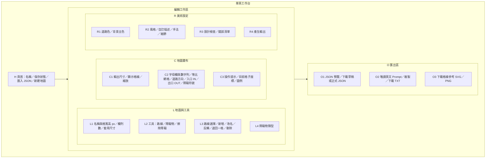
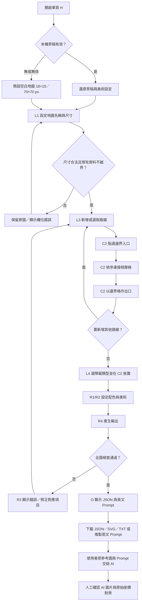
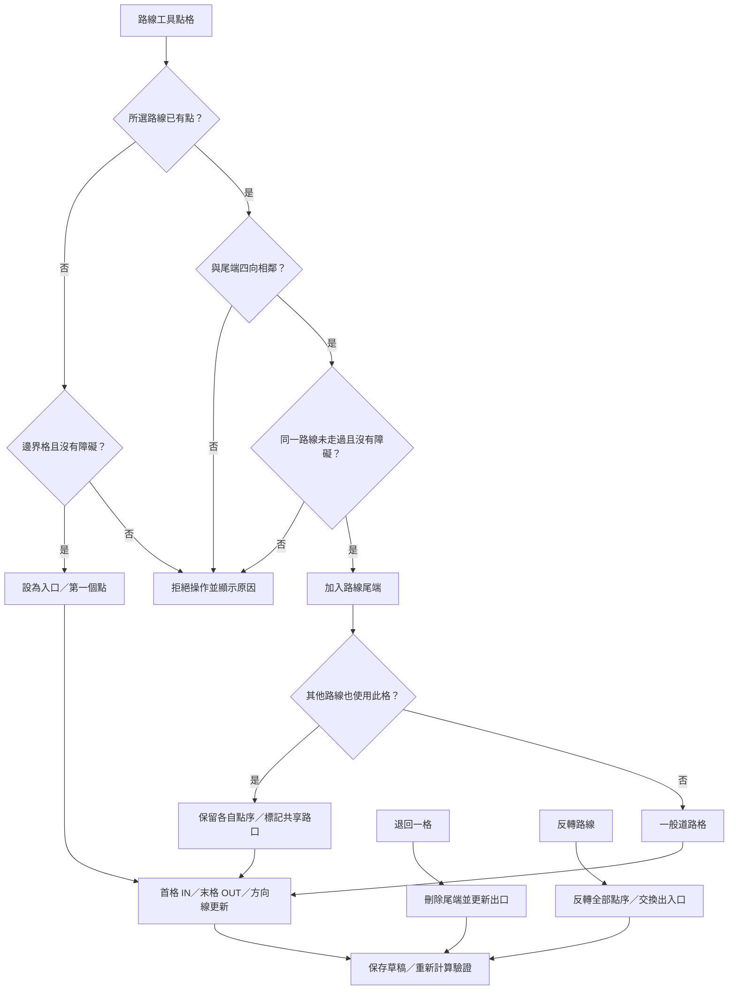
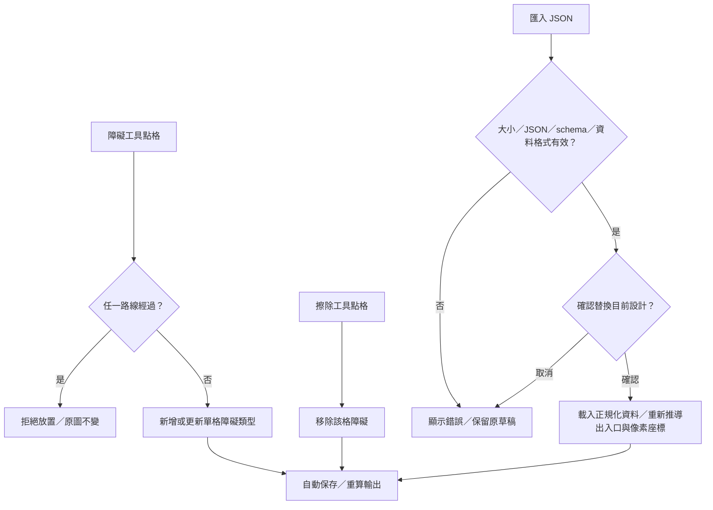
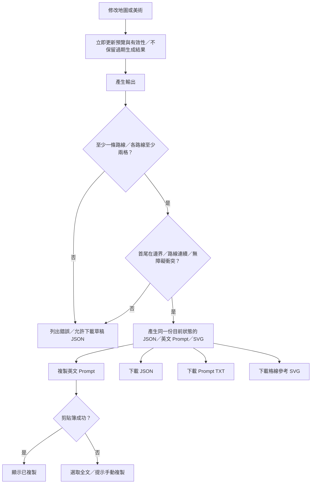
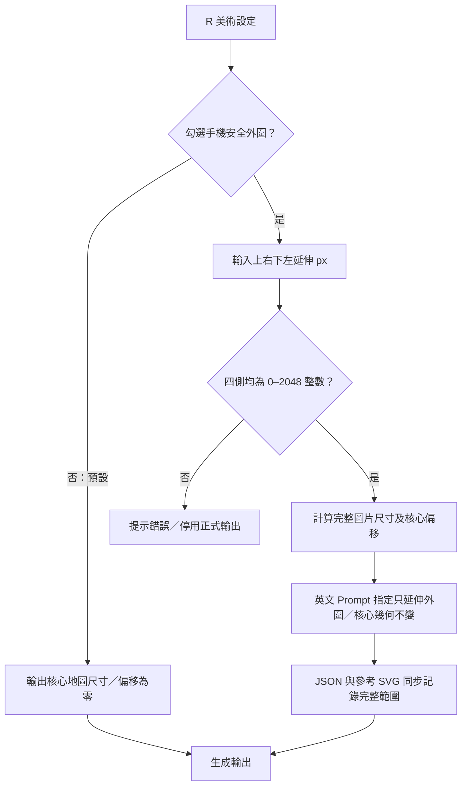

# TD Map Create 規格

日期：2026-11-05。階段：規格先行，實作與驗收狀態另見 README。

## 1. 目的與範圍

獨立、通用的塔防地圖設計工具。簡潔的一頁式繁體中文介面，所有資料處理在瀏覽器完成。使用 Vue 3、Vite、TypeScript，建置為 GitHub Pages 可提供的靜態 HTML/CSS/JS。無後端、帳號、AI API 或秘密金鑰，不自動生成 AI 圖片。使用者將輸出的英文 Prompt、參考圖與 JSON 交給 AI。

本文件僅依本產品需求制定，不引入其他專案的程式、素材、設定或相容格式。

## 2. 已確認需求與初版界線

| 項目 | 規則 |
|---|---|
| 格子尺寸 | 寬、高分開設定，預設各 70 px |
| 地圖大小 | 欄、列分開設定，預設 18 欄 × 10 列 |
| 地圖範圍 | 輸出寬 = 欄數 × 格寬；輸出高 = 列數 × 格高，預設 1260 × 700 px |
| 縮放 | 僅改畫面顯示比例，不改資料、座標或匯出尺寸；不得非等比拉伸 |
| 道路 | 多條有順序的四向相鄰路線；每條首格為入口、末格為出口 |
| 路口 | 多條路線可以共享格子／出入口；依各路線點序行進，交會不自動換路 |
| 障礙物 | 逐格設定，類型為樹木、岩石、建物；不得與任何道路重疊 |
| 美術 | 道路與背景主色各自的顏色選擇器；風格、手法、細節為獨立下拉選單 |
| 輸出 | 完整地圖 JSON、英文 Prompt 複製／TXT 下載、格線參考 SVG／PNG |
| 保存 | 瀏覽器自動保存一份草稿；JSON 可備份與重新匯入 |
| 介面 | 簡單一頁式，不設登入、首頁廣告或多頁導覽 |

初版實作決策：欄列 2–64、格寬高 8–256 px，最多 16 條路線；不支援斜向、跨格自動尋路或同一路線重複經過同一格。路線至少兩格且首尾必須在地圖邊界，才可生成正式輸出。尚未完成的設計可隨時下載草稿 JSON。這些是初版產品界線，不是引擎限制。

## 3. 完整畫面配置

桌面為單頁三欄工作區；上方頁首，下方全寬輸出區。日系簡約淡色介面：米白底、淡灰綠輔色、深灰綠文字、系統字型、清晰細框與留白，不使用裝飾性插畫。所有按鈕有可讀文字與鍵盤焦點。



窄螢幕依序顯示頁首、地圖設定／工具、畫布、美術設定、輸出。畫布區可水平捲動；整頁不得因畫布超寬而橫向捲動。輸入欄位不超出容器，按鈕可換行，操作目標至少 44 px。大型網格可用縮放或畫布內捲動瀏覽。UI 使用 px 指輸出座標尺度，CSS 顯示大小會隨縮放改變。

| 區塊 | 輸入／動作 | 回饋與狀態 |
|---|---|---|
| H | 匯入 JSON | 先解析及驗證，成功後詢問替換；取消或失敗保留目前資料 |
| H | 新建 | 有目前設計時確認清除；建立預設空白地圖 |
| L1 | 套用尺寸 | 整數範圍檢查；縮小若造成裁切則拒絕並說明，要求先移除越界資料 |
| L2 | 切換工具 | 選中樣式與文字提示；不修改地圖 |
| L3 | 新增路線 | 新 ID 與可編輯名稱，選中新路線；超過上限顯示原因 |
| L3 | 退回一格／反轉 | 尾端移除，或將點序反轉並交換入口／出口 |
| L3 | 刪除 | 確認後移除整條路線；共享格仍由其他路線保留 |
| C2 | 路線工具點格 | 第一格須在邊界；後續只能接尾端上下左右一格；不連續／重複／障礙則拒絕 |
| C2 | 放障礙 | 空地可新增或更新障礙類型；道路上拒絕 |
| C2 | 擦除 | 只移除障礙；路線用退回或刪除操作，避免誤切斷 |
| C2 | 鍵盤 | 方向鍵在格子間移動，Enter／Space 套用目前工具 |
| R | 更改美術 | 即時預覽顏色，更新輸出；美術選項不影響幾何 |
| R4 | 產生輸出 | 全圖驗證；錯誤時列明路線／原因並停留；成功捲到輸出區 |
| O | 複製 Prompt | 成功顯示「已複製」；失敗選取文字並提示手動複製 |
| H | 自動保存 | 顯示已保存或保存不可用；存儲失敗不阻止下載 |

## 4. 操作流程

### 4.1 主要流程與畫面對應



### 4.2 路線、出入口與交會



入口／出口由每條路線明確擁有。相同格位可作多條路線的共同入口或出口。共享格稱為 junction，僅表示幾何重疊，不授權改道。完整路線陣列是行進權威，不從道路聯集自行尋路。

### 4.3 障礙物與匯入保護



### 4.4 生成、複製與下載



## 5. 座標與 JSON 契約

- `schemaVersion: 1`。座標原點左上，x 向右、y 向下，格座標從 0 起算。
- 地圖不含額外外框／HUD／出血範圍。入口出口位於圖內邊界格。
- 格子左上像素 = `(x × cellWidth, y × cellHeight)`；中心 = `((x + 0.5) × cellWidth, (y + 0.5) × cellHeight)`。
- 每條路線有穩定唯一 ID、名稱及按行進順序排列的 `cells`。`entry`、`exit`、`centerlinePx` 為推導資料。
- 畫布及 SVG／PNG 障礙符號統一為「障」，JSON 保留內部類型，英文 Prompt 僅稱 obstacles，不提樹木／岩石／建物。畫布列、欄都固定分配尺寸，文字不得撐開格線。

障礙逐格記錄 `cell`、`kind` 以及推導的 `rectPx`；相鄰障礙可視覺合併，但不得擴大占格。
- `roadCells` 為道路格聯集；`junctions` 列共享格及 routeIds；均由 routes 推導。
- `status` 為 `draft` 或 `ready`，必須由完整驗證推導，不信任匯入聲明。
- 匯入只採用已知欄位，驗證型別、有限整數、邊界、重複 ID／座標、顏色與選項白名單。忽略及重建推導欄位。檔案上限 2 MB。
- 草稿可有未完成路線；結構錯誤、跨格或道路障礙重疊則拒絕匯入。

最小完成範例（2×2 地圖，所有尺寸皆為 px）：

```json
{
  "schemaVersion": 1,
  "name": "Sample map",
  "status": "ready",
  "grid": {"columns": 2, "rows": 2, "cellWidth": 70, "cellHeight": 70},
  "canvasPx": {"width": 140, "height": 140},
  "coordinateSystem": {"origin": "top-left", "indexBase": 0, "unit": "px"},
  "routes": [{"id": "route-1", "name": "Route 1", "cells": [{"x": 0, "y": 0}, {"x": 1, "y": 0}], "entry": {"x": 0, "y": 0}, "exit": {"x": 1, "y": 0}, "centerlinePx": [{"x": 35, "y": 35}, {"x": 105, "y": 35}]}],
  "roadCells": [{"x": 0, "y": 0}, {"x": 1, "y": 0}],
  "junctions": [],
  "obstacles": [{"cell": {"x": 0, "y": 1}, "kind": "rock", "rectPx": {"x": 0, "y": 70, "width": 70, "height": 70}}],
  "art": {"roadColor": "#cbb899", "backgroundColor": "#dce6d0", "style": "japanese-cute", "medium": "watercolor", "detail": "color-blocks"}
}
```

## 6. 英文 Prompt

介面說明為中文，但固定模板與內建選項的 Prompt 為英文；自訂風格描述原文帶入，可能包含使用者輸入的中文。使用固定英文模板與選項對照，不把中文地圖名稱／路線名稱放入 Prompt；以 route ID 辨識路線。沒有外部翻譯服務。

| 欄位 | 選項（中文 → 英文） |
|---|---|
| 風格 | 日系可愛、奇幻童話、自然寫實、極簡、美式漫畫、手繪、油墨、像素、童書繪本、復古卡通、剪紙拼貼、線稿、自訂風格；各內建選項有英文對照 |
| 手法 | 水彩、水粉、數位繪畫、像素畫、墨水、鉛筆、色鉛筆、油畫、麥克筆、版畫；各選項有英文對照 |
| 細節 | 色塊 → clean color blocks；適中 → balanced detail；精緻 → fine environmental detail |

自訂風格描述最多 500 字，可搭配內建風格，或選自訂風格；選自訂時必須有描述。原文以引號放入 visual style notes，不翻譯，僅適用美術外觀，不取代幾何條件。`art.customDescription` 保存原文，舊檔缺少時預設空字串。

畫布橫軸使用 A–Z、AA…，縱軸使用 1、2…；A1 = 數值 (0,0)。Prompt 路線與障礙使用 `B2 (1,1)` 格式。JSON 仍以零起算數字為權威，coordinateSystem 註明對應。SVG／PNG 在核心頂列與左欄內標示軸標籤，不增加圖片尺寸。

Prompt 包含：精確輸出寬高與長寬比、格寬高、欄列、零起算座標／格心公式、各路線完整有序座標及入口出口、障礙逐格座標（統一使用 obstacles，不描述具體種類）、道路色與背景主色、三項美術選擇。指定正上方 2D 俯視、無透視扭曲、完整一格寬道路、保持幾何、障礙輪廓不得侵入其他格；相鄰同類可組成自然群落但占格不變。空格保持開放，不加阻擋。

負面限制：no grid lines, no coordinates, no labels, no arrows, no text, no UI, no borders, no characters, no units, no extra roads, no extra obstacles。要求參考圖作為 geometry guide，將其標記排除在正式圖片之外。工具不能保證 AI 逐像素對齊；輸出區提示使用者帶入參考圖，產圖後需人工核對。參考 SVG 是示意圖，不宣稱是 AI 完成背景。

## 7. 技術與檔案

- Vue 3 單一頁面元件；TypeScript 純函式模組處理模型、驗證、英文 Prompt 與 SVG，不把業務規則綁死 DOM。
- CSS 原生樣式與系統字型，無遠端字型、追蹤或圖片依賴。
- SVG 繪製地圖且等比顯示；鍵盤可操作格子；所有外部文字使用 Vue escaping／SVG escaping，不拼接未處理 HTML。
- localStorage key `tdmapcreate.draft.v1`。只保存地圖原始狀態，渲染時推導輸出；失敗顯示狀態。
- GitHub Actions 執行 `npm ci`、測試、`npm run build`，發布 `dist` 到 Pages。Vite base 為 `/tdmapcreate/`。不使用需伺服器 rewrite 的路由。
- 編輯器未來可擴充程式工具介面；初版 AI 互通契約為 JSON＋英文 Prompt＋參考圖，不宣稱已有 MCP 或網站內 AI 生圖能力。

## 8. 驗收清單

| ID | 案例 | 預期 |
|---|---|---|
| T01 | 初始開啟 | 18×10、70×70 px、1260×700 px |
| T02 | 非正方格 40×80／6×4 | 240×320 px，中心計算正確，畫面保持比例 |
| T03 | 0、負數、小數、空值、超上限 | 拒絕且原資料不變 |
| T04 | 縮小導致資料越界 | 拒絕，無靜默裁切 |
| T05 | 單路建立、反轉、退回、刪除 | 有序點正確，入口出口同步 |
| T06 | 跨格、斜向、同路重複、起點非邊界 | 阻止並顯示原因 |
| T07 | 雙路共享入口／出口／中段 | 各自點序保留、共享格可追溯 routeIds |
| T08 | 障礙與道路互相覆蓋 | 雙向都阻止 |
| T09 | 三種障礙新增／更新／擦除 | 座標、類型與像素矩形同步 |
| T10 | 美術選項與色彩 | 畫布與英文 Prompt 同步 |
| T11 | 未完成路線 | 禁止正式 Prompt／參考圖，草稿 JSON 可下載 |
| T12 | JSON 匯出→匯入 | 原始狀態一致、推導欄位重新產生 |
| T13 | 損壞／惡意／超大 JSON | 拒絕，既有設計保留 |
| T14 | 英文 Prompt | 包含全部路線、障礙、尺寸與選項；無中文名稱混入；自訂描述允許原文 |
| T15 | 複製／下載 | 成功提示；剪貼簿不可用有手動備援 |
| T16 | 重新整理／本機儲存失敗 | 還原有效草稿；失敗時仍可下載 |
| T17 | 375／768／1440 寬 | 一頁式順序正確、按鈕可操作、畫布不拉伸 |
| T18 | 鍵盤與焦點 | 工具、欄位、格子、輸出都可操作 |
| T19 | SVG | viewBox 與輸出尺寸一致、文字安全轉義 |
| T20 | Pages 子路徑 | 靜態資源載入、重整可用，無後端依賴 |

實際通過、待測與發布狀態分開紀錄；本機建置不代表 Pages 已上線。

## 9. 手機安全外圍（2026-11-05 補充需求）

R 美術設定新增「手機安全外圍」核取方塊，預設不勾選；勾選後展開上／右／下／左四個 px 欄位，初版預設各 70 px，允許 0–2048 的整數。這是背景圖片延伸，不代表作業系統 UI safe-area。

核心格線尺寸與所有格座標不變。完整圖寬 = 核心寬＋左＋右；完整圖高 = 核心高＋上＋下。核心區左上位置為 (左, 上)。關閉時四側實際延伸皆為 0；保留欄位值供下次使用。JSON `art.safeBorder` 保存 enabled／top／right／bottom／left，並由輸出 `imagePx` 提供完整尺寸與 `coreOffsetPx`。原本 `canvasPx` 及路線像素座標仍以核心原點計算；欲轉換到完整圖片須加 coreOffsetPx。

英文 Prompt 說明完整圖片尺寸、核心矩形與座標偏移，要求只在核心網格外補足連續背景，禁止縮放／移動核心道路與障礙，不新增道路或可部署格。外圍為可裁切景物，不放關鍵內容，不能把延伸當成圖框。參考 SVG 同步延伸外圍底色，格線與幾何僅位於核心區。編輯畫布仍編輯核心地圖，旁列完整圖片尺寸與核心偏移。

驗收 T21：預設關閉時輸出尺寸不變。T22：左右上下不對稱延伸時，英文 Prompt／JSON／SVG 的尺寸與偏移一致。T23：切換選項不改核心網格、路線或障礙。T24：非法外圍數值阻止輸出與匯入。



PNG 使用瀏覽器 Canvas 將 SVG 轉換，無伺服器。為避免記憶體耗盡，限制單邊 8192 px、總計 1,600 萬像素；超過時提示改用完整 SVG。
